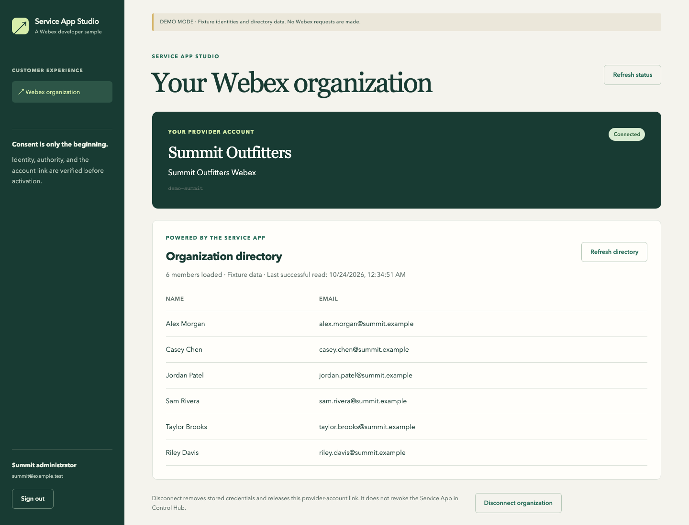

# Webex Service App Provider Sample

A small web app for validating **customer-initiated organization linking**. A customer approves a Service App in Webex, signs into their provider account, verifies their Webex administrator identity through a separate OAuth Integration, and explicitly confirms the organization link. Only then does the backend retrieve Service App tokens and read that organization's directory.

Two authenticated experiences share one backend:

- **Provider administrator:** configure the provider Integration, inspect customer connection metadata, and exercise simulated Control Hub approvals in demo mode. This role cannot view customer directories.
- **Customer administrator:** verify a Webex account, confirm the organization link, read a paginated directory, and disconnect. This role sees only its own provider tenant.

This is an independent sample, not an official onboarding requirement or a production SaaS platform. Webex API behavior is covered by mocked contract tests; live acceptance requires your own registered apps and organization. See [validation](docs/VALIDATION.md).



The [provider console screenshot](docs/screenshots/provider-console.png) shows the separate administrative experience. Both screenshots use fictional demo data.

## Run locally

Requires **Node.js 24.13 or later in the 24.x release line**. There are no runtime dependencies and no `npm install` step. Node's built-in SQLite module currently emits an experimental-feature warning.

```sh
git clone https://github.com/WebexSamples/webex-service-app-provider-sample.git
cd webex-service-app-provider-sample
npm run setup
npm start
```

Choose `demo` during setup. Set a password of 12–256 characters for each local account; passwords are hidden during interactive entry and stored as salted scrypt hashes. There are no default passwords.

Open [http://localhost:3000](http://localhost:3000). Setup creates:

| Experience | Local account | Provider tenant |
| --- | --- | --- |
| Provider administrator | `provider@example.test` | Provider console |
| Customer administrator | `summit@example.test` | Summit Outfitters |
| Customer administrator | `northstar@example.test` | Northstar Travel |

Use separate browser profiles or private browsing contexts for simultaneous sessions. Different tabs in one profile share the same account session.

### Try the demo

1. As the provider, select **Connect demo Integration**.
2. Under **Simulated Control Hub**, authorize the Summit Outfitters Webex fixture. Approval does not link or activate any tenant.
3. In another browser context, sign in as the Summit customer.
4. Select the Summit fixture and **Full Administrator**, then **Verify fixture identity**. Choosing **Organization member** demonstrates the authority denial.
5. Review the organization and provider account; select **Confirm link and activate Service App**.
6. Select **Refresh directory**, then **Load more members**. These reads use the saved Service App connection, without retaining a customer OAuth token.
7. As Northstar, try claiming the same Summit Webex fixture. The existing tenant claim blocks it.
8. As the provider, deauthorize the Summit fixture. Refresh the customer status: credentials have been removed and access is disconnected. Reauthorization alone does not reactivate it; verify and confirm again.

The permanent **DEMO MODE** banner identifies fixture data. Demo mode makes no Webex requests, and demo mutation endpoints are disabled in live mode. The fixture authority selector is intentionally a simulation, not an authentication mechanism.

## Use real Webex apps

Follow [live setup](docs/LIVE_SETUP.md). It describes the Service App, the two separate OAuth Integration registrations, scopes, callback URLs, and optional signed lifecycle webhooks.

Before App Hub approval, validate real APIs inside the Service App developer's organization. The provider and customer **application accounts** remain separate; this does not establish external-organization availability. [App Hub transition](docs/APP_HUB_TRANSITION.md) lists the remaining changes and acceptance tests.

The app binds to loopback. An HTTPS tunnel or reverse proxy can expose it for OAuth callbacks and webhooks; configure its exact public origin as `BASE_URL`, preserve the public Host header, and keep it bound to loopback. This is not authorization to deploy the sample or create Webex apps automatically.

## Checks

```sh
npm run check
npm test
```

`npm test` covers real HTTP sessions, CSRF, role restrictions, explicit consent, conflicting tenant claims, disconnect/recovery, signed deauthorization, OAuth state, token contexts, encryption, and Webex request/response contracts. No Webex credentials or GitHub credentials are needed.

For browser smoke tests, install Python Playwright and its Chromium browser in a development environment, then run `python3 scripts/browser_smoke.py`. This is optional test tooling, not an application dependency. It launches an isolated fixture server and writes screenshots to ignored `artifacts/`.

## Implementation

| Path | Purpose |
| --- | --- |
| `server.mjs` | Loopback HTTP server and startup |
| `lib/app.mjs` | Sessions, permissions, OAuth, linking, directory, lifecycle events |
| `lib/webex.mjs` | Fixed-origin Webex API calls and response validation |
| `lib/security.mjs` | Password hashing, authenticated encryption, identity normalization |
| `lib/store.mjs` | SQLite persistence and audit history |
| `public/` | Browser UI; no secrets or third-party scripts |
| `test/` | Node's built-in test runner |

Mode-specific databases live in `.data/demo.sqlite` and `.data/live.sqlite`. Sessions, pending OAuth states, and short-lived identity proofs live only in memory and expire; restarting requires sign-in and a fresh verification. Directory entries are returned to the customer's browser and are not persisted in SQLite. Tokens are encrypted with tenant-bound AES-256-GCM; the ignored `.env` contains the local encryption key and configured Webex client secrets. Back up the key separately from the database. Changing or losing the key makes saved credentials unreadable.

Keep `.env`, `.data/`, runtime artifacts, and customer data out of Git. See [security boundaries](SECURITY.md), [contributing](CONTRIBUTING.md), and the [MIT license](LICENSE).
