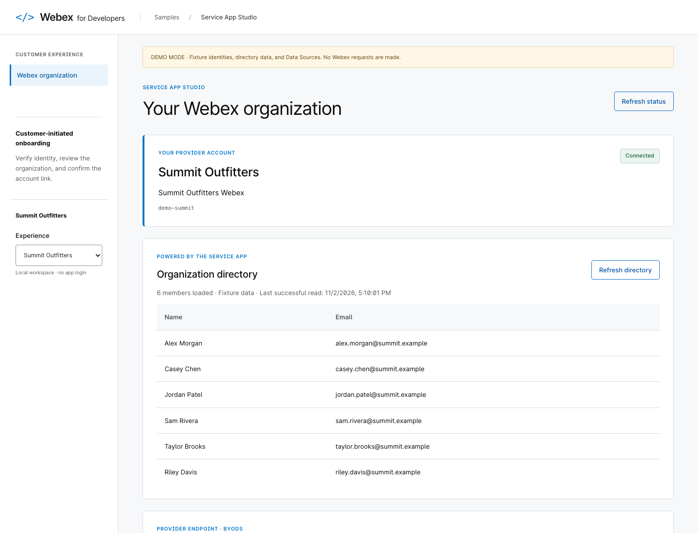
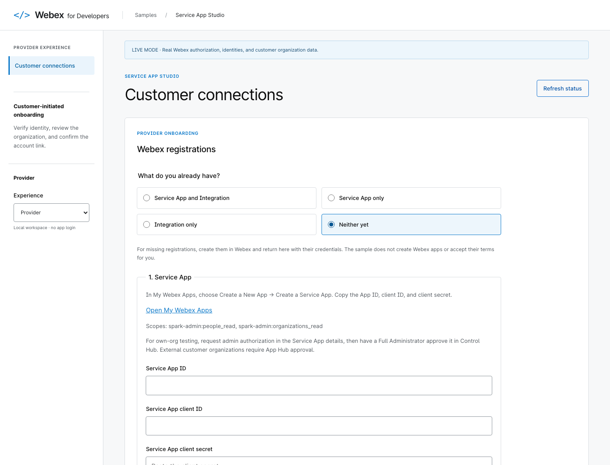
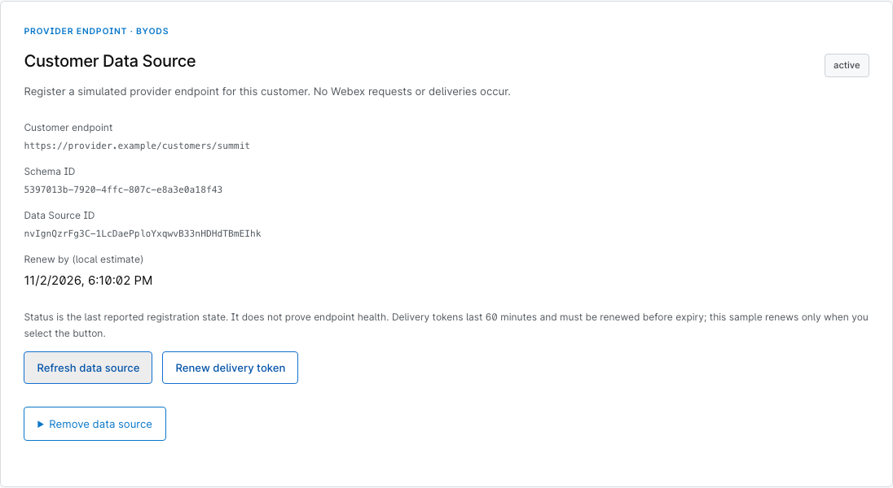

# Webex Service App Provider Sample

A small web app for validating **customer-initiated organization linking**. A customer approves a Service App in Webex, signs into their provider account, verifies their Webex administrator identity through a separate OAuth Integration, and explicitly confirms the organization link. Only then does the backend retrieve Service App tokens and read that organization's directory.

Two experiences share one backend:

- **Provider administrator:** configure the provider Integration, inspect customer connection metadata, and exercise simulated Control Hub approvals in demo mode. This role cannot view customer directories.
- **Customer administrator:** verify a Webex account, confirm the organization link, read a paginated directory, manage an optional Data Source registration, and disconnect. This role sees only its own provider tenant.

This is an independent sample, not an official onboarding requirement or a production SaaS platform. Webex API behavior is covered by mocked contract tests; live acceptance requires your own registered apps and organization. See [validation](docs/VALIDATION.md).



The [provider console screenshot](docs/screenshots/provider-console.png) shows the separate administrative experience. Both screenshots use fictional demo data.

## Run locally

Requires **Node.js 24.13 or later in the 24.x release line**. The server uses Node's built-in APIs; the browser uses locked Momentum Design components, theme tokens, and fonts served locally. Node's built-in SQLite module currently emits an experimental-feature warning.

```sh
git clone https://github.com/WebexSamples/webex-service-app-provider-sample.git
cd webex-service-app-provider-sample
npm ci --ignore-scripts
npm start
```

No environment variables, `.env` file, or local account are required. Open **http://localhost:3000** to enter the provider workspace. Use **Experience** in the sidebar to switch between **Provider**, **Summit Outfitters**, and **Northstar Travel**. These are local sample perspectives; Webex OAuth still verifies the developer/customer identity, and linking a customer organization still requires explicit confirmation.

The provider's **Webex registrations** screen supports an existing Service App, an existing provider Integration, both, or neither. For missing registrations, it shows the Webex portal link, required scopes, and exact callbacks. Create those registrations in Webex, then paste their credentials into the app. Customer verification still uses a separate Integration. You can save one complete registration at a time and finish the others later.



Saved secrets are encrypted in the mode's SQLite database and never returned to the browser. The app generates `.data/master.key` with mode `0600` inside a `0700` directory. Back up that key separately from the databases; losing it makes saved credentials unreadable. Existing `.env` configuration is supported for migration: the app preserves its encryption key and imports the registration credentials into encrypted storage. After verifying the migration and backing up the key, you can remove the old `.env` file. New secrets are managed through the UI.

The selected experience belongs to the browser session. Use separate browser profiles for simultaneous provider/customer views; tabs in one profile share the selection. Switching clears pending Webex verification and directory results, while saved organization connections remain intact.

For fictional demo data, stop live mode and run:

```sh
npm start -- --demo
```

Demo and live mode have separate databases. Both open without a local login. Demo mode doesn't require Webex registrations. Older installations keep their saved settings and connections. Use `npm start -- --live` to override a legacy demo-mode setting without editing `.env`.

### Try the demo

1. In the **Provider** experience, select **Connect demo Integration**.
2. Under **Simulated Control Hub**, authorize the Summit Outfitters Webex fixture. Approval does not link or activate any tenant.
3. Switch **Experience** to **Summit Outfitters**.
4. Select the Summit fixture and **Full Administrator**, then **Verify fixture identity**. Choosing **Organization member** demonstrates the authority denial.
5. Review the organization and provider account; select **Confirm link and activate Service App**.
6. Select **Refresh directory**, then **Load more members**. These reads use the saved Service App connection, without retaining a customer OAuth token.
7. Switch to **Northstar Travel** and try claiming the same Summit Webex fixture. The existing tenant claim blocks it.
8. Switch to **Provider** and deauthorize the Summit fixture. Refresh the customer status: credentials have been removed and access is disconnected. Reauthorization alone does not reactivate it; verify and confirm again.

The permanent **DEMO MODE** banner identifies fixture data. Demo mode makes no Webex requests, and demo mutation endpoints are disabled in live mode. The fixture authority selector is intentionally a simulation, not an authentication mechanism.

### Try the Data Source example

After linking a demo customer, open **Register a data source** under **Customer Data Source**, review its customer-specific endpoint, and select **Confirm register data source**. Then refresh its status, renew its delivery token, or expand **Remove data source** and confirm removal. Directory access remains connected after removal.

Demo registrations are persisted fixtures. Live mode uses the Webex Data Sources API with the customer's Service App token. The provider configures the approved schema and endpoint in the existing setup screen; no new environment variables are needed. See [Data Source setup and boundaries](docs/DATA_SOURCES.md).



To unlink a customer, expand **Disconnect organization**, review the effect, and select **Confirm disconnect**. Opening the disclosure leaves the connection active. Control Hub authorization is managed separately.

## Use real Webex apps

Follow [live setup](docs/LIVE_SETUP.md). It describes the Service App, the two separate OAuth Integration registrations, scopes, callback URLs, and optional signed lifecycle webhooks.

Before App Hub approval, validate real APIs inside the Service App developer's organization. The provider and customer **workspaces** remain separate; this does not establish external-organization availability. [App Hub transition](docs/APP_HUB_TRANSITION.md) lists the remaining changes and acceptance tests.

The app binds to loopback. Password-free perspective selection is available only with a loopback origin. Anyone who can access that local workspace can use its saved connections. A public HTTPS origin retains separate password-protected provider/customer accounts and first-run setup; no perspective-switch endpoint is enabled there. An HTTPS tunnel or reverse proxy can expose it for OAuth callbacks and webhooks; start with `npm start -- --origin https://sample.example.com`, preserve that public Host header, and keep the server bound to loopback. Use `--port 3001` to change the local listener. This is not authorization to deploy the sample or create Webex apps automatically.

## Checks

```sh
npm run check
npm test
```

`npm test` covers real HTTP sessions, CSRF, role restrictions, explicit consent, conflicting tenant claims, disconnect/recovery, signed deauthorization, OAuth state, token contexts, encryption, and Webex request/response contracts. No Webex credentials or GitHub credentials are needed.

For browser smoke tests, install Python Playwright and its Chromium browser in a development environment, then run `python3 scripts/browser_smoke.py`. This is optional test tooling, not an application dependency. It launches an isolated fixture server and writes screenshots to ignored `artifacts/`.

## Implementation

| Path | Purpose |
| --- | --- |
| `server.mjs` | Loopback HTTP server and startup |
| `lib/config.mjs` | Private local key creation and registration-field allow-list |
| `lib/app.mjs` | Sessions, permissions, OAuth, linking, directory, Data Sources, lifecycle events |
| `lib/webex.mjs` | Fixed-origin Webex API calls and response validation |
| `lib/security.mjs` | Password hashing, authenticated encryption, identity normalization |
| `lib/store.mjs` | SQLite persistence and audit history |
| `public/` | Browser UI with Momentum Design; no secrets or CDN requests |
| `test/` | Node's built-in test runner |

Mode-specific databases live in `.data/demo.sqlite` and `.data/live.sqlite`. Sessions, pending OAuth states, and short-lived identity proofs live only in memory and expire; restarting opens the provider experience on localhost and requires fresh Webex verification for a new organization link. Public HTTPS origins require local-account sign-in again. Directory entries are returned to the customer's browser and are not persisted in SQLite. Tokens and registration credentials are encrypted with AES-256-GCM under separate authenticated contexts; the ignored `.data/master.key` holds the local encryption key. Back up the key separately from the database. Changing or losing the key makes saved credentials unreadable.

Keep `.env`, `.data/`, runtime artifacts, and customer data out of Git. See [security boundaries](SECURITY.md), [contributing](CONTRIBUTING.md), and the [MIT license](LICENSE).

The UI uses `@momentum-design/components` pinned to `0.137.2`, matching the Developer Portal Contributor Hub, with pinned theme/font packages in `package-lock.json`. The server exposes only the required asset paths, keeping the existing same-origin Content Security Policy. Native form controls preserve browser validation and keyboard access. Public-origin login fields retain password-manager support.
