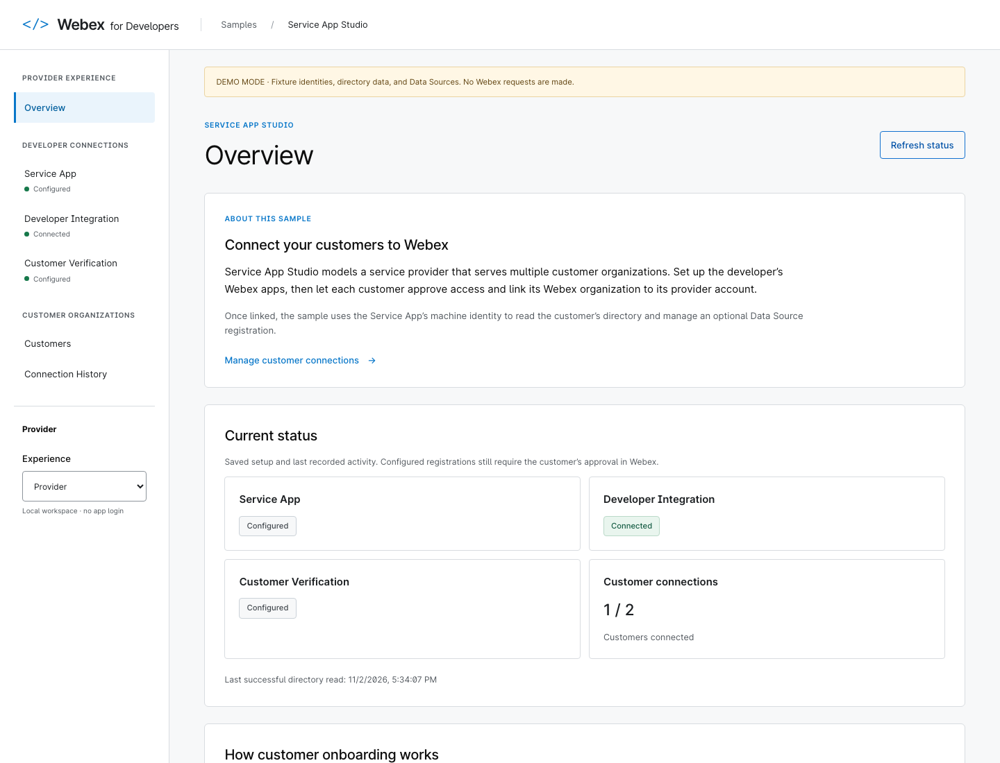
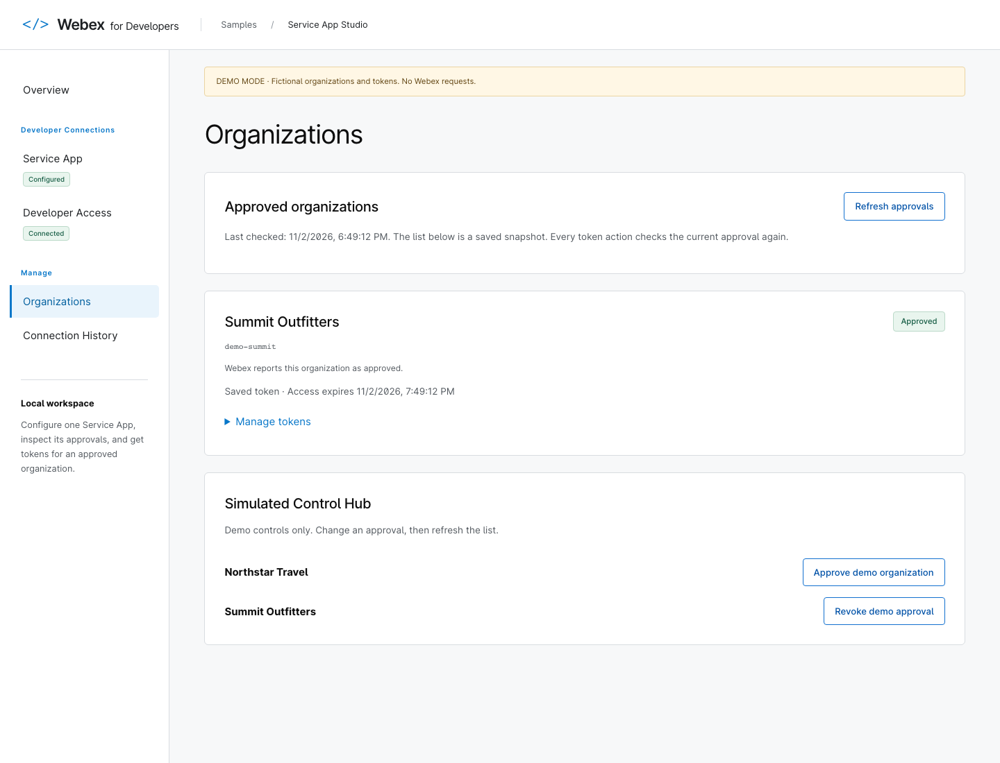

# Webex Service App Studio

A local console for maintaining a Webex Service App. Configure the app, see its approved organizations, and retrieve or refresh a token pair for a selected organization.



## Run locally

Requires **Node.js 24.13+ in the 24.x release line**.

```sh
git clone https://github.com/WebexSamples/webex-service-app-provider-sample.git
cd webex-service-app-provider-sample
npm ci --ignore-scripts
npm start
```

Open **http://localhost:3000**. No app login or environment variables are required. The app binds to loopback and rejects public origins and unexpected Host headers. Anyone with access to this local workspace can use its saved credentials.

1. **Service App:** save its app ID, client ID, and client secret from [My Webex Apps](https://developer.webex.com/my-apps). Add its name and Manage URL if desired. After connecting developer access, the app name comes from Webex.
2. **Developer Access:** paste the Service App creator's [personal access token](https://developer.webex.com/admin/docs/getting-started#your-personal-access-token) and select **Connect PAT**. The app verifies ownership and loads approvals.
3. **Organizations:** inspect approved organizations. Expand **Manage tokens** and choose **Retrieve token pair**. Once a pair is saved, you can refresh it or reveal the saved pair. Each action rechecks approval in Webex.



Token values appear only after an explicit token action. Use the copy controls if needed, then **Hide tokens**. Navigation, errors, and a periodic five-minute clear remove them from the view. The clipboard is not automatically cleared. Ordinary status responses contain expiry metadata only.

**Refresh approvals** reloads the organization list from Webex. Otherwise, the list is a saved snapshot with a last-checked timestamp. This console does not grant approvals; administrators manage them in Control Hub.

## Temporary PAT access

Organization listing uses the Developer Portal's **experimental, unpublished** `GET /v1/applications/{applicationId}` response and its `authorizationsList`. The public API specification and Integration scope catalog do not currently expose this read path. API publication and scope enablement are separate work.

The sample restricts listing to the app creator's PAT. A normal Integration with `spark:applications_token` alone cannot read this list. PATs are temporary testing credentials and are unsuitable for a production provider service. See [live setup](docs/LIVE_SETUP.md) and [App Hub transition](docs/APP_HUB_TRANSITION.md).

The PAT stays only in server memory for the browser session. It is discarded on disconnect, settings changes, restart, or session expiry (30 minutes idle, eight hours absolute). It is never stored in SQLite, localStorage, or an environment file. An expired PAT must be replaced. Disconnecting a PAT does not revoke existing Service App tokens.

## Saved credentials

The app generates `.data/master.key` with mode `0600` in a `0700` directory. Registration secrets, organization snapshots, and Service App token pairs are encrypted in `.data/live.sqlite` using AES-256-GCM. Token pairs are bound to the Service App ID, client ID, and organization ID. Blank secret fields preserve the saved secret; changing an ID requires supplying the matching secret.

Back up the key separately from the database. Losing the key makes saved credentials unreadable. Existing installations keep their encrypted settings, legacy tables, and key. Old Integration credentials and customer connections are retained but unused. This version removes the customer-linking, directory, Data Source, and webhook workflows. It does not delete registrations or revoke grants in Webex.

Legacy `.env` values can still be loaded by `npm start`, including the original encryption key. Save Service App settings in the UI to persist them locally. New installations need no `.env` file. Do not put a PAT in one.

## Try fictional data

Stop live mode, then run:

```sh
npm start -- --demo
```

Connect **demo developer** under Developer Access. Open Organizations to retrieve a fictional Summit Outfitters token pair. Use **Simulated Control Hub** to approve or revoke fixture organizations, then refresh approvals. Revoked organizations cannot pass a new token action. Demo mode never calls Webex and uses a separate database.

Use `npm start -- --live` to override a legacy demo setting. To change the port, use `npm start -- --port 3001`.

## Checks

```sh
npm run check
npm test
```

The tests cover local sessions, CSRF and origin checks, owner verification, approval changes, encrypted token contexts, refresh handling, concurrency, and legacy-data preservation. No Webex credentials are needed. Optional browser checks require Python Playwright with Chromium:

```sh
python3 scripts/browser_smoke.py
```

The browser test starts isolated servers without reading `.env`, checks setup/restart and token actions, and verifies 320px and 390px layouts. Screenshots in `artifacts/` contain fixtures only. See [validation evidence](docs/VALIDATION.md).

## Implementation

| Path | Purpose |
| --- | --- |
| `server.mjs` | Loopback server and startup |
| `lib/config.mjs` | Private encryption key and Service App field validation |
| `lib/app.mjs` | Local sessions, temporary PAT, approvals, token actions |
| `lib/webex.mjs` | Fixed-origin Webex calls and response validation |
| `lib/security.mjs` | Authenticated encryption and organization identity normalization |
| `lib/store.mjs` | SQLite persistence and audit history |
| `public/` | Momentum Design UI, served locally |

The browser dependencies remain pinned in `package-lock.json`; no CDN requests are needed. Keep credentials, databases, customer data, and private artifacts out of Git. See [security](SECURITY.md), [contributing](CONTRIBUTING.md), and the [MIT license](LICENSE).
